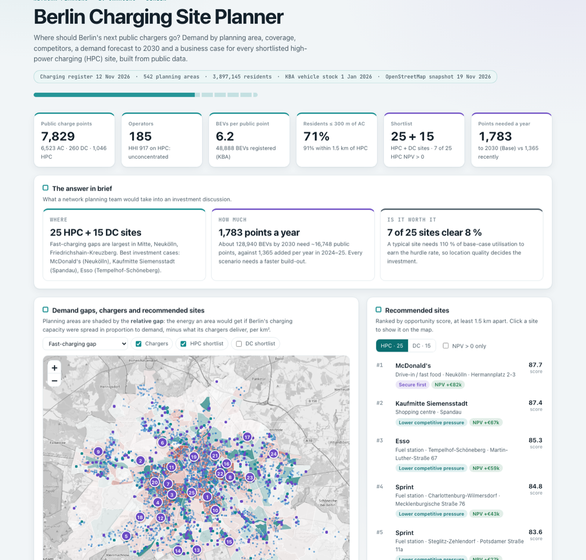

<div align="center">

# Berlin Charging Site Planner

**Where should Berlin's next public EV chargers go? A location analysis from public data: demand
by planning area, coverage, competitive landscape, a system-dynamics demand forecast, an
out-of-time validated competitor-entry model and an Excel business case for every shortlisted site.**

[](https://github.com/Kiran-koppera/berlin-charging-site-planner/actions/workflows/ci.yml)
[](https://github.com/Kiran-koppera/berlin-charging-site-planner/actions/workflows/deploy.yml)


### [▶ Live dashboard](https://kiran-koppera.github.io/berlin-charging-site-planner/) · [Excel business case](https://kiran-koppera.github.io/berlin-charging-site-planner/downloads/hpc-business-case.xlsx) · [with VBA macros](https://kiran-koppera.github.io/berlin-charging-site-planner/downloads/hpc-business-case-macros.xlsm) · [Method](docs/methodology.md) · [System dynamics](docs/system-dynamics.md) · [Data quality](docs/data-quality.md)



</div>

> Independent portfolio project built on open data. Not affiliated with any charging operator.
> Candidate host sites come from OpenStreetMap; no business has been contacted.

---

## The question

A network planning team has to decide **where** to put **which type** of charger, and whether the
site will pay back. This project answers that for Berlin with public data only:

1. **Supply:** every public charge point in the Bundesnetzagentur register, cleaned and grouped into sites.
2. **Demand:** residents per planning area × BEV ownership × public-charging need, plus through traffic.
3. **Gap and coverage:** which of the 542 planning areas are under-served, and how many residents are within reach of a charger.
4. **Competition:** operator shares by points, power and HPC; market concentration.
5. **Sites:** 4,600 candidate hosts scored and a spaced shortlist of 25 HPC and 15 DC sites.
6. **Outlook:** BEV fleet and charge points needed to 2030 from a calibrated stock-and-flow model.
7. **Money:** NPV, IRR and payback per site in a formula-driven Excel model with scenarios.

## Results (charging register of 12 Nov 2026)

| | |
|---|---|
| Supply | **7,829 public charge points** (6,523 AC, 260 DC, 1,046 HPC ≥ 150 kW) at 3,573 sites from 185 operators; 352 MW installed |
| Demand | 48,888 BEVs in Berlin (KBA, 1 Jan 2026) → **6.2 BEVs per public point** |
| Coverage | **71 %** of residents live within 300 m of an AC point; **91 %** within 1.5 km of HPC |
| Gaps | Fast-charging gaps are largest in Mitte, Neukölln and Friedrichshain-Kreuzberg; AC gaps in Pankow and Neukölln |
| Competition | Unconcentrated market (HHI 917 for HPC points); the top HPC operator holds 21 % of HPC points |
| Outlook | Base scenario: **~129,000 BEVs by 2030** need ~16,700 public points, **~1,780 a year** vs. 1,365 a year added in 2024–25 |
| Business case | 4 × 300 kW site, €490k capex: Base NPV **−€76k** (IRR 5.3 %, payback 9 years); **7 of 25** shortlisted sites clear an 8 % hurdle |
| Validation | Competitor-entry model: **out-of-time AUC 0.61**; top fifth of sites 1.7× as likely to get a competitor HPC |
| Data quality | 12 checks on the register: coordinates outside Berlin, wrong postcodes, point power above device power, duplicates |

### What the data says

* **Location decides the investment.** At base-case assumptions a typical HPC site misses an 8 %
  return by a small margin (it needs 110 % of base utilisation). Sites with heavy traffic, few
  competitors nearby and a short-stop host clear it; the rest do not.
* **Operators build where the traffic is, not where residents lack chargers.** In the backtest,
  2025–26 HPC openings followed road traffic (AUC 0.58) and host type (0.57), while residential
  gaps had no predictive power (0.48). The inner-city AC gap is an open opportunity.
* **Good hosts are the scarce resource.** No operator dominates Berlin. Forecourts of fuel brands
  with their own HPC networks are closed to third parties, so retail, drive-in and independent
  fuel-station partnerships decide who expands.

## How it works

```
Bundesnetzagentur register ─► parse + 12 quality checks ─► devices → sites → charge points
Berlin LOR areas + population ─► 250 m population grid ─┐
Traffic counts 2023 ────────────────────────────────────┼─► demand, capacity, relative gap per area
KBA vehicle stock 2023-2026 ────────────────────────────┘          │
OpenStreetMap hosts ─► score (gap, traffic, whitespace, host fit) ─┴─► spaced shortlist
                                    │                                    │
           backtest + logistic competitor-entry model          Excel business case per site
                                    │                                    │
      system-dynamics forecast ─────┴──────────► dashboard (Leaflet, Chart.js) on GitHub Pages
```

Details: [methodology](docs/methodology.md) · [system dynamics](docs/system-dynamics.md) ·
[data quality](docs/data-quality.md) · [business case](docs/business-case.md) · [sources](docs/data-sources.md).

## Excel business case

[`hpc-business-case.xlsx`](https://kiran-koppera.github.io/berlin-charging-site-planner/downloads/hpc-business-case.xlsx):
a scenario dropdown (Pessimistic / Base / Optimistic) drives every input through `CHOOSE`; a
10-year cash flow with NPV, IRR and payback; a per-site sheet where each shortlisted location's
score scales utilisation and its own cash flow, NPV and IRR are live formulas; a tornado and a
price × utilisation grid. Tests recalculate the workbook formulas and check they equal the Python model.

**Macro version** ([`hpc-business-case-macros.xlsm`](https://kiran-koppera.github.io/berlin-charging-site-planner/downloads/hpc-business-case-macros.xlsm),
source: [`ScenarioRunner.bas`](src/chargeplan/vba/ScenarioRunner.bas)):

| Macro | Shortcut | What it does |
|---|---|---|
| `RunAllScenarios` | Ctrl+Shift+R | Switches the scenario dropdown through Pessimistic, Base and Optimistic, recalculates, and writes NPV, IRR, payback, sites with NPV > 0 and every site's NPV to a *Scenario results* sheet; restores the original scenario |
| `BreakEvenPrice` | Ctrl+Shift+B | Goal Seek on the cash-flow NPV to find the net price at which one site breaks even, then restores the input |

openpyxl cannot write VBA, so [`vba.py`](src/chargeplan/vba.py) builds the VBA project itself from
Microsoft's published file-format specifications ([MS-OVBA] streams, compression and encoding;
[MS-CFB] container). Tests check the result with independent readers (olefile, olevba).

## Quick start

```bash
git clone https://github.com/Kiran-koppera/berlin-charging-site-planner.git
cd berlin-charging-site-planner
make install      # virtual environment + dependencies
make data         # public data into data/raw (~75 MB)
make run          # analysis, shortlist, forecast, workbook, dashboard -> output/
make serve        # dashboard at http://localhost:8000
make test         # 32 tests on synthetic data (no download needed)
```

## Repository

```
src/chargeplan/
  register.py   parse the charging register, 12 quality checks, sites and points
  areas.py      planning areas, population grid, traffic, OpenStreetMap hosts, distances
  analysis.py   demand, capacity, relative gap, coverage, competition, history
  sites.py      candidate scoring, spaced shortlist, backtest
  ml.py         competitor-entry model (logistic regression, out-of-time validation)
  forecast.py   system-dynamics model of BEVs and public points
  excel.py      business case workbook and its Python twin
  vba.py        VBA project writer ([MS-OVBA], [MS-CFB]) and .xlsm packaging
  vba/          ScenarioRunner.bas: the Excel macros
  pipeline.py   end-to-end run
site/           dashboard (HTML, CSS, JS)
tests/          pytest on synthetic inputs
docs/           methodology, system dynamics, data quality, business case, sources
```

## Limits

* The register only lists devices whose operators completed notification; real supply is larger.
* Demand counts Berlin-registered cars. Fleets, car sharing and ride-hailing cars registered
  elsewhere add demand, so city-wide utilisation is understated; the *relative* gap is not affected.
* No grid-capacity data. Medium-voltage availability decides many HPC sites and has to be checked
  with the grid operator before any site goes further.
* Costs and prices are planning assumptions with a stated basis, not supplier quotes.

## Licence

Code: MIT. Data: Bundesnetzagentur (CC BY 4.0); Kraftfahrt-Bundesamt; Amt für Statistik Berlin-Brandenburg
(LOR, CC BY 3.0 DE); Senatsverwaltung für Stadtentwicklung, Bauen und Wohnen (MSS 2025); Land Berlin
(traffic volumes, dl-de/zero-2-0); © OpenStreetMap contributors (ODbL). Details in [data-sources.md](docs/data-sources.md).
