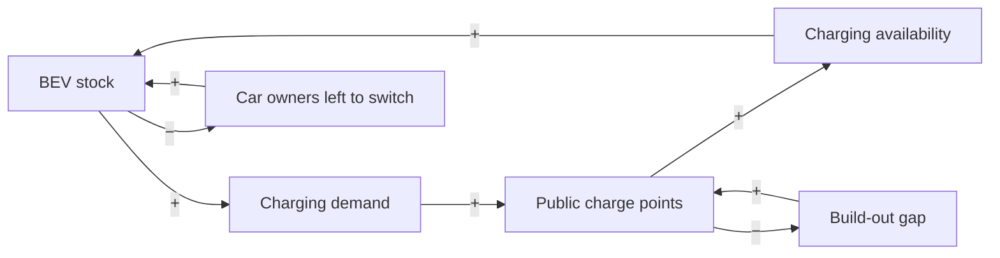

# System-dynamics model

A stock-and-flow model of Berlin's EV market and public charging network, built in Python the way
one would build it in Vensim: two stocks, two flows, auxiliaries and three feedback loops,
integrated with Euler steps of a quarter year (TIME STEP = 0.25). Code: [`forecast.py`](../src/chargeplan/forecast.py).

## Causal loop diagram



* **R1, availability (reinforcing):** more public points → better availability → more people
  switch to a BEV → more demand → operators build more points.
* **B1, saturation (balancing):** the more BEVs, the fewer car owners left to switch.
* **B2, build-out (balancing):** points are built in proportion to the gap between the target
  network (BEVs ÷ target BEVs per point) and today's network; the gap closes as they are built.

## Equations

```
adoption     = r · B · (1 − B / K) · (availability / availability₀) ^ elasticity
availability = C / B
target       = B / bev_per_point
build        = max(target − C, 0) / build_time
B(t+dt)      = B(t) + dt · adoption
C(t+dt)      = C(t) + dt · build
```

* **Data:** BEV stock on 1 January 2023–2026 (KBA FZ1: 24,934; 35,815; 41,988; 48,888) and public
  points in operation on the same dates (register, by commissioning date: 2,136; 3,965; 5,362; 6,695).
* **Target BEVs per point:** 7.3, the latest observed ratio (it has fallen every year).
* **Calibration:** grid search over r and build time, least squares on log values of both series.
* **Scenarios:** market ceiling K (25 / 50 / 80 % of today's car stock) and availability elasticity
  (0.2 / 0.4 / 0.7). Fit error 4.9–5.2 % (RMSE on logs).

## Results

| Scenario | BEVs 2030 | Public points 2030 | Points to add per year |
|---|---|---|---|
| Slow | 116,121 | 15,217 | 1,477 |
| Base | 128,940 | 16,748 | 1,783 |
| Fast | 133,259 | 17,246 | 1,883 |

Points added in 2024 and 2025 and still in operation: 1,365 a year on average. Every scenario
needs a faster build-out than that. The four years of history pin down the near term, so the
scenarios differ little by 2030 and diverge after.

## Limits

* Survivorship: points decommissioned before Nov 2026 are missing from the history, so early
  network size is understated.
* The calibrated build time sits at the lower bound of the grid (0.25 years): the network has been
  catching up faster than the BEV fleet grows, which the target ratio captures only roughly.
* Berlin is treated as one market; the spatial detail is in the location analysis, not here.
